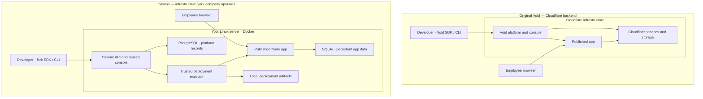

# Casimir

Casimir gives your company a place to share the small apps your team uses at work.

A teammate creates a useful tool, makes it available through Casimir, and
colleagues open it in their browser. The app and the information it stores stay
on computers your company controls.

The included example is a shared notes app: write a note, save it, and see it
when you return.

**Warning: Casimir is an experiment.**

See the [walkthrough](docs/casimir-walkthrough/WALKTHROUGH.md) for pictures of
someone sharing and using an app with Casimir.

## Casimir and Void

The current server profile runs Node/SQLite apps on a Linux Docker server.
It uses the Void SDK and reuses the original management console.

**Casimir brings the Void publishing experience to a fully self-hosted application
stack.** The management API and console, app execution, platform database,
application data and deployment artifacts run on infrastructure you operate.
The supported Casimir profile has no operational dependency on Cloudflare.

The comparison below describes the pinned upstream Void source used by this
project, not every possible Void deployment or its latest release.

| Area | Original Void platform | Casimir developer preview |
| --- | --- | --- |
| Hosting | Cloudflare-backed platform and application services | Your Linux server, using Docker |
| Publishing | Void SDK and CLI targeting the original platform | Packed fork SDK and CLI targeting your Casimir server; `void` / `@void/*` names retained |
| Management | Original Void management interfaces | Reused embedded console with Casimir branding; broader parity is unfinished |
| Control and storage | Cloudflare Workers and service bindings, including R2 and Durable Objects | Node control API, PostgreSQL metadata and local deployment artifacts |
| App execution and data | Cloudflare application runtime and bindings | Supported Node/SQLite app profile with persistent Docker volumes |
| Operations | Cloudflare supplies the hosting infrastructure | Your team operates TLS, storage, backups and server maintenance |



Sign-in requires an operator-configured identity provider. It can be hosted
internally or supplied by an external service; Casimir does not bundle one.
DNS, HTTPS certificates and server administration are also operator-managed.
Source builds fetch dependencies; self-hosted operation does not imply an
air-gapped build or installation.

## Install on your own server

Start with the [quickstart](QUICKSTART.md) for the supported source-build,
operator enrollment and bundled reference-app publish path. The detailed
[installation guide](casimir/install/README.md) defines the complete procedure.

1. Build a standalone bundle using the [source build guide](casimir/install/README.md#clean-source-build-package-and-tests).
2. Verify it and configure HTTPS on separate control and application hostnames.
3. Follow the [operator guide](casimir/install/README.md#installation-and-tls), configure your OIDC provider, and enroll the administrator.
4. Publish the bundled notes example with the packed fork SDK, then open its app URL and console.

The operator profile is Linux amd64 with rootful Docker, classic `overlay2`
storage and Compose. Follow the exact [support boundary](casimir/install/SUPPORT.md).
Source builds need more resources than a running app. Application tooling,
builds and tests run in Docker; the documented workflow needs no host Node install.

From the built bundle, the basic operator commands are:

```sh
./casimir bundle verify
./casimir install --state /var/lib/casimir/operator --config /private/config/config.json
./casimir auth-setup --state /var/lib/casimir/operator --auth-config /private/config/auth.json --auth-secrets /private/config/auth-secrets.json
./casimir status --state /var/lib/casimir/operator
```

Create the referenced private files for your own installation, outside this
checkout and bundle. The [full guide](casimir/install/README.md) supplies their
schemas, identity-policy option and lifecycle instructions. After enrollment,
use browser sign-in; do not rerun `auth-setup` as a status or update command.

## Source and contributions

An [offline illustrated walkthrough](docs/casimir-walkthrough/index.html) is also
included.

This snapshot includes the Casimir adapter, installer, reference app, reused
management components, SDK/framework source, tests and usage documentation.
SDK names remain `void` and `@void/*`. Original framework docs under `docs/`
also describe Cloudflare features; Casimir's operator/support guides define
this preview's self-hosted scope.

Read [CONTRIBUTING.md](CONTRIBUTING.md) and [TESTING.md](TESTING.md).
Use synthetic examples; never attach real credentials, dumps or private server
information to issues. Automatic deployment/publication workflows are absent.

## Attribution and license

Based on [Void](https://github.com/voidzero-dev/void), originally examined at
version1.1.11, revision `a38b1f874e16e52a9b32539163f80f2ba6c6b966`.
The original [MIT license](LICENSE) and third-party notices are retained.
Adapted syntax-highlighting theme notices remain in
[their source directory](platform/packages/api/src/admin/react/themes/LICENSE)
and are included by the standalone packager. Casimir branding does not imply
upstream endorsement. [SOURCE-PROVENANCE.json](SOURCE-PROVENANCE.json) identifies
the product source used for this preparation.

## Experimental status

**Status: experimental developer preview.** The bounded install → SDK deployment → browser
write → app update → backup → independent restore → compatible upgrade workflow
has been exercised. Full Void feature parity, multiuser operation, arbitrary
applications and production readiness are still open. The Casimir branding,
fresh installation, administrator enrollment, normal OIDC sign-in, SDK publishing
and data-preserving app update have been verified in controlled staging.
Fresh offline SDK preparation also passed using writable copies of the shipped
caches. Follow the verified developer-container profile in the installation guide. This source snapshot does not include a prebuilt release.

The quickstart source build, fresh install, OIDC sign-in, SDK publishing and
browser write/refresh were reproduced from the public source in a new isolated
Docker store on the existing staging VM. Clean-VM and host-reboot qualification
remain open; see [source provenance](SOURCE-PROVENANCE.json).

The optional upstream account dashboard
remains a separate surface with incomplete Casimir qualification.

This is a bounded developer preview, not a complete replacement for Cloudflare
or every Void feature. See the [tested support boundary](casimir/install/SUPPORT.md).
