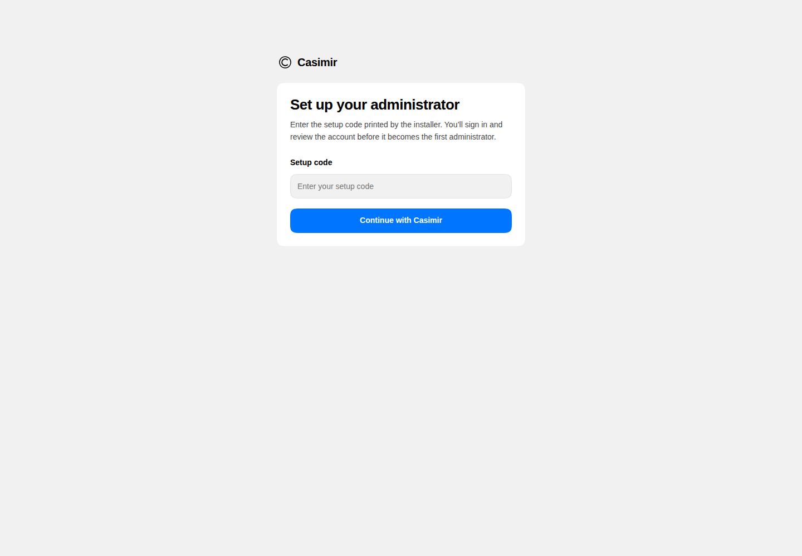
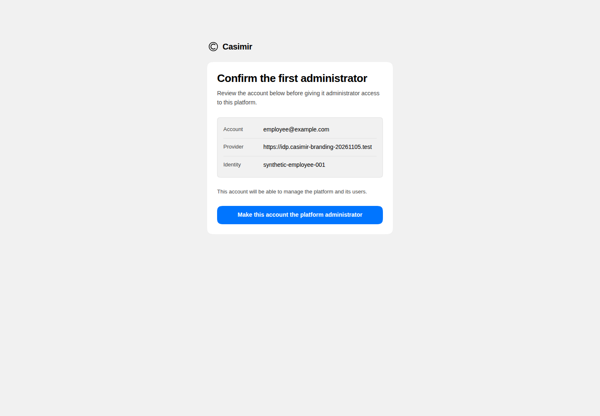
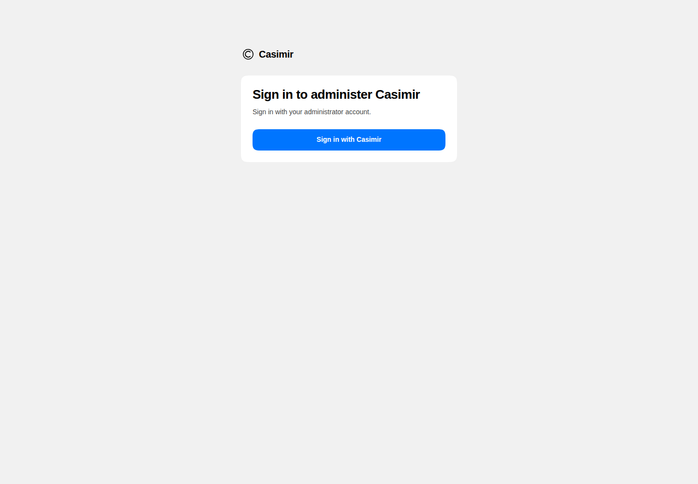
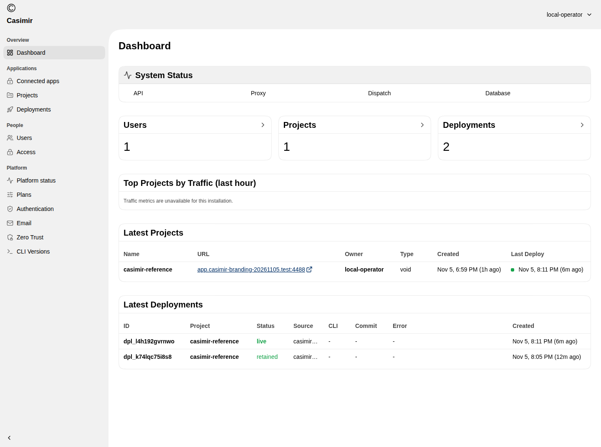
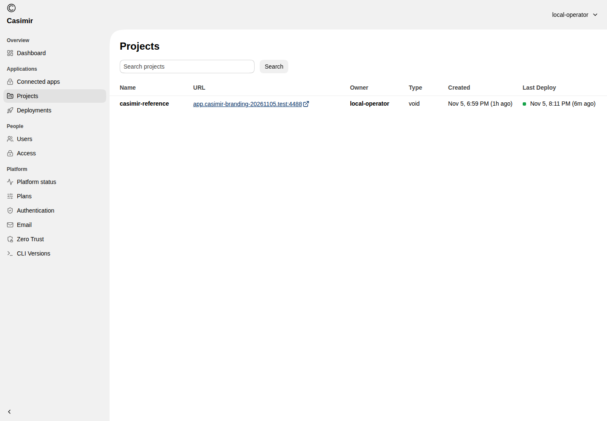
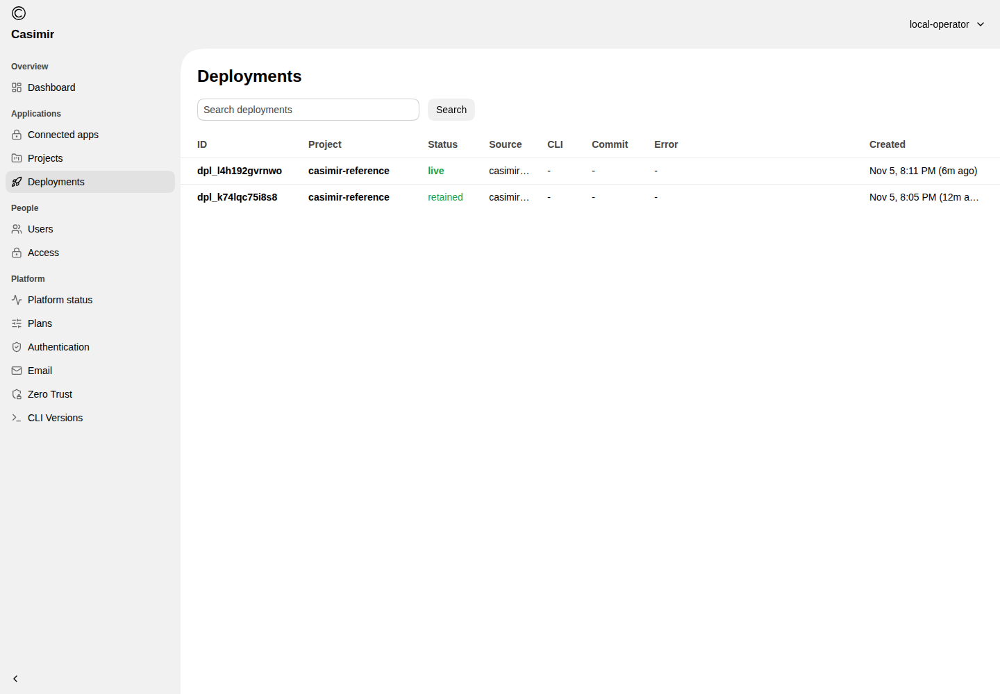

# Publish an app, then see it in the company console

Casimir is a private self-hosted preview for running internal applications on a
company’s own server. Developers publish with the Void SDK. Administrators use
the Casimir console, adapted from Void.

**Install → Enroll administrator → Publish → Use → Review → Update**

## 1. An administrator prepares the company service

Install the supplied standalone release on a controlled Linux server with the
qualified Docker profile. Configure separate secure addresses for the console
and applications, then connect the company’s OIDC identity provider.
[Installation steps](INSTALLATION.md) cover the supported operator commands.
This report contains no credentials or release archive.

Open the setup address printed by the installer, enter its private setup code,
and continue to the company sign-in page.

After sign-in, review the identity before confirming the first administrator.
The identity below is synthetic demonstration data.

Later visits use normal company sign-in. The demonstrated flow verified
normal sign-in in a fresh browser session.

## 2. A developer publishes an app

Prepare the app with the bundled Void SDK and publish it to the company’s
Casimir project. The administrator supplies the server address, project and
private publishing access. Use the instructions shipped with that exact release.

The demonstrated app is a small shared notes tool. Publishing gives it a secure
app address that the developer can share inside the company. Publishing remains
a developer SDK workflow.

## 3. An employee opens and uses the app

Open the app address, enter a note and save it. The note appears in the list and
remains after refresh. The developer then published an update; the existing
note remained and a second was saved.

This is one shared demonstration app. Separate employee permissions and arbitrary
application compatibility are outside this verified path.

## 4. The administrator reviews the published app

The Casimir console shows the same SDK-published project and its deployments.
The dashboard shows records for the same published app. Traffic
metrics are explicitly unavailable in this preview.

Open **Projects** to find the application and its secure URL.

Open **Deployments** to see the current live deployment and retained previous
release. These are real deployment records from the demonstrated app.

The screenshots show the running Casimir branding on the reused interfaces.
Other navigation items remain subject to their own functionality checks.
This report verifies enrollment, normal sign-in and these views;
it does not establish the full management feature set.

## 5. Keep the service and its data

An earlier controlled lifecycle trial also exercised encrypted backup,
independent restore and one compatible platform upgrade with retained notes.
Those checks were separate from this fresh branded installation and were not
repeated for these screenshots. Use the lifecycle commands shipped with the
reviewed bundle and keep backup keys private.

## Scope of this preview

The demonstration uses one trusted operator, one project and synthetic data.
It is a functional proof for a controlled environment. Multiuser operation,
production readiness and full Void feature parity remain unverified.

Screenshots are unchanged captures of the actual app and Casimir console.
See [evidence and scope](SOURCES.md). Nothing in this walkthrough publishes
Casimir or the demonstration app publicly.
